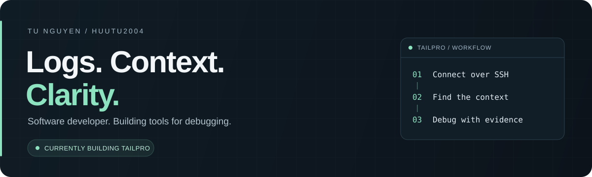

  

  <a href="#building-tailpro">Building TailPro</a> &nbsp;·&nbsp;
  <a href="#how-i-build">How I build</a> &nbsp;·&nbsp;
  <a href="https://github.com/HuuTu2004/HuuTu2004/discussions">Let's talk</a>

### Hi, I'm Tu.

I'm a software developer building **TailPro**, a desktop log explorer for developers who debug services over SSH.

My current focus: making it easier to move from scattered logs to useful context, while keeping the developer in control of their data and tools.

### Building TailPro

**Your servers. Your logs. One workspace.**

TailPro brings remote file and Docker logs into a local desktop app. Connect through OpenSSH, explore multiple sources, filter events, and inspect the details without installing a TailPro agent on your servers.

- **Investigate in one place.** Multi-source viewing, saved queries, structured JSON inspection, and pause/resume.
- **Keep control of what leaves the app.** Preview redacted incident exports and explicitly grant external tools access to selected sources.
- **Bring context to your coding tools.** A scoped MCP bridge lets compatible clients read log evidence. Optional error explanations use a configured local or BYOK model.

**Built with:** Rust · Tauri · React · TypeScript · OpenSSH

**Status:** Early development, with Linux as the initial target. Runtime validation is ongoing; packaged releases are still ahead. Public source and release links will be added here when available.

### How I build

I care about tools that are useful in everyday debugging:

- **Local-first workflows** with explicit boundaries around remote access and model access.
- **Clear evidence** about what happened, including gaps and incomplete results.
- **Bounded resource use** so a burst of logs has predictable limits.

### Let's build better debugging tools

I'd like to hear from developers who spend time debugging services over SSH, work on observability tooling, or connect coding agents to real runtime evidence.

Have a workflow TailPro should support? [Start a conversation](https://github.com/HuuTu2004/HuuTu2004/discussions). A concrete example of where your current tools get in the way is a great place to begin.

English and Vietnamese are both welcome. Please use synthetic or redacted examples when sharing logs.
